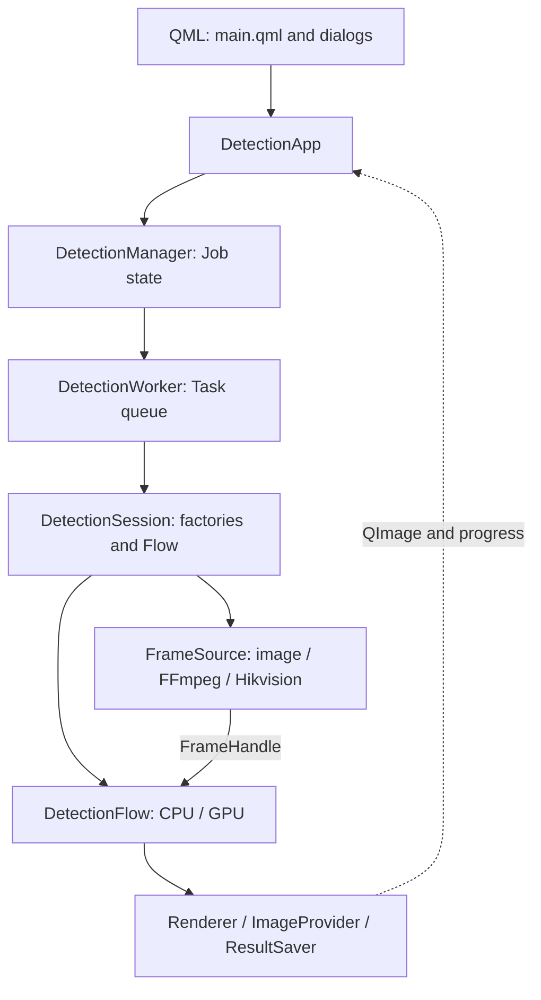

# YOLO: realtime object detection desktop application

[](LICENSE)
[](CMakeLists.txt)
[](https://www.qt.io/)
[](https://onnxruntime.ai/)
[](https://opencv.org/)

[简体中文](README.zh-CN.md)

This project uses Qt Quick/QML for the desktop interface and C++ for frame acquisition, preprocessing, ONNX inference, postprocessing, and result display. It supports images, video files, ordinary camera devices through FFmpeg, and Hikvision industrial cameras through the MVS SDK.

You can use it to try a trained YOLO model on local media, inspect a camera feed, review previous detections, and save annotated results. The source also provides a working example of separating a QML interface from CPU/GPU inference and measuring individual stages of the pipeline. It runs exported models; model training and dataset annotation are outside its current scope.

The current build scripts target Windows x64 and include Windows library and DLL deployment rules. Other platforms require build and device-integration changes.

## Contents

- [Current functionality](#current-functionality)
- [Technology stack](#technology-stack)
- [Architecture](#architecture)
- [Performance monitoring](#performance-monitoring)
- [Directory structure](#directory-structure)
- [Build](#build)
- [Usage and configuration](#usage-and-configuration)
- [Model contract and output](#model-contract-and-output)
- [Planned updates](#planned-updates)
- [Troubleshooting](#troubleshooting)
- [License](#license)

## Current functionality

- Single-image, video, camera, Hikvision camera, and mixed image/video batch detection. A Job groups user-visible progress; the worker executes its individual Tasks.
- CPU and GPU detection flows. The CPU path uses BGR frames; the GPU path accepts decoded CUDA/NV12 frames and CPU BGR images uploaded by the session.
- FFmpeg software decoding and a CUDA hardware-decoding path. Hikvision acquisition stays inside its own frame source, including device enumeration and trigger settings.
- Letterbox preprocessing, YOLO output parsing, coordinate restoration, and CPU NMS. GPU preprocessing uses custom CUDA kernels.
- CPU fallback for errors that request recovery, with configuration and warning updates passed back to QML. Invalid inputs remain task errors rather than a reason to switch every job to CPU.
- Live preview, bounded result review, cancellation, and optional annotated image/video saving.
- A separate non-modal performance window with a log view, overall frame statistics, and stage timings. The main window also retains a log view.
- A one-click example action that resolves sample files from the executable's `examples/` directory. The build copies this directory when it exists.

## Technology stack

| Area | Technology and responsibility |
|---|---|
| Language | C++23 in the top-level CMake configuration; CUDA sources use C++17 |
| Interface | Qt 6, Qt Quick/QML, Quick Controls, Qt Multimedia |
| Model runtime | ONNX Runtime; existing dependency setup uses 1.30, with CPU/CUDA execution paths |
| Image processing | OpenCV; existing setup uses 5.0, for image reading, CPU preprocessing, drawing, and conversion |
| Media input | FFmpeg, including software decode and CUDA hardware contexts |
| GPU | CUDA Toolkit, cuDNN, custom BGR/NV12 preprocessing kernels |
| Industrial cameras | Hikvision MVS SDK; the configure warns and skips this layer when the SDK is absent |
| Monitoring | `IPerformanceMonitor`, `PerformanceMonitor`, `NullPerformanceMonitor`, `ScopedStageTimer` |
| Build and tests | CMake, Ninja/MSVC, Qt Test, CTest |

## Architecture

The project has a QML interface, an application layer, and a core layer. QML submits user actions and displays properties. The application layer handles jobs, tasks, session lifetime, result delivery, and monitoring. The core layer provides frame sources, frame handles, factories, and detection flows without depending on QML.

The diagram below renders directly in the GitHub README. The matching [HTML architecture document](docs/architecture.html) contains the manually laid out overview and a separate performance-monitoring diagram. Download the HTML file and open it in a browser to view that version; the repository file link opens the HTML source on GitHub. No GitHub Pages deployment is required for the diagram below.



### Current execution model

`DetectionApp` submits a frame-source description. `DetectionManager` creates a Job and its Tasks, tracks progress, and submits Tasks to `DetectionWorker`. The worker still owns a `std::queue<std::unique_ptr<DetectionTask>>`; the planned Job queue has not replaced it.

The worker creates and holds `DetectionSession` on its working thread. The session selects CPU/GPU factories, creates sources, and owns the selected Flow. Session lifetime currently follows worker setup and recovery rather than a strict create/destroy cycle for each Job. The Manager tracks Job state and propagates fallback updates; the Worker performs session recovery.

| Module | Responsibility |
|---|---|
| `DetectionApp` | QML commands, detection configuration, progress, result review, banners |
| `DetectionManager` | Job/Task construction, task-event aggregation, cancellation, fallback updates |
| `DetectionWorker` | Task queue, execution loop, Session ownership, frame processing and result publication |
| `DetectionSession` | Mode selection, source/flow factories, warm-up, CPU-image upload for the GPU path |
| `FrameSource` / `FrameHandle` | Separate input type from frame storage; image, FFmpeg, and Hikvision sources share the handle contract |
| `CpuDetectionFlow` / `GpuDetectionFlow` | Preprocessing, ONNX inference, common CPU postprocessing |
| Renderer / ImageProvider / ResultSaver | Draw annotated frames, publish QImage results for review, save files |
| `PerformanceApp` | Own the monitor and expose snapshots and configuration to QML |

### CPU/GPU paths and display

```text
CPU: CPU BGR frame -> CpuPreprocessor -> CpuDetector -> CPU postprocessing/NMS
GPU video: CUDA/NV12 frame -> CudaPreprocessor -> GpuDetector -> CPU postprocessing/NMS
GPU image: CPU BGR frame -> Session upload -> BGR CUDA kernel -> GpuDetector -> CPU postprocessing/NMS
Display/save: CPU image -> DetectionRenderer -> QImage / annotated output files
```

GPU inference does not make the current display path GPU-only. Display and saving still use CPU drawing and QImage conversion. Direct GPU display with a Qt Overlay remains planned.

## Performance monitoring

`PerformanceApp` is created before the QML interface and passed to `DetectionApp`. The detector and its lower layers borrow an `IPerformanceMonitor` pointer. `ScopedStageTimer` records elapsed time at scope exit or an explicit `end()` call; disabled stages are filtered by a bitmask.

The monitor accumulates records under a lock and generates snapshots. `PerformanceApp` converts nanoseconds to milliseconds at the display boundary and exposes stage averages, maxima, sample counts, FPS, successful/failed frame counts, and end-to-end statistics. Snapshots are emitted only while detection is running. These are timings of the instrumented host scopes; they should not be treated as CUDA-event measurements of kernel execution or as isolated UI-renderer latency.

| Level | Current collection points |
|---|---|
| Off | `NullPerformanceMonitor`; no stage collection |
| Basic | End-to-end statistics and overall frame counts/FPS; startup default |
| Detailed | Basic plus read-frame, preprocessing, inference, postprocessing, drawing, and saving |
| Full | Detailed plus the upload stage |

The startup report interval is 300 ms. Changing between enabled levels or changing the interval applies at runtime and resets the statistics window. Switching between Off and an enabled level is rejected with a restart-required warning; the startup configuration currently comes from `PerformanceConfig` in `src/main.cpp`, so there is no persistent switch yet. Memory/GPU sampling flags exist in the configuration model, but a complete memory sampler and CUDA-event timing are not implemented.

## Directory structure

```text
.
├── CMakeLists.txt
├── cmake/
├── src/
│   ├── main.cpp
│   ├── app/
│   │   ├── runtime/       # DetectionApp, Manager, Worker, Session, PerformanceApp
│   │   └── components/    # Renderer, ImageProvider, ResultSaver, Logger, PerformanceMonitor
│   └── core/
│       ├── base/         # DetectionTypes, DecodeTypes, Box, errors
│       ├── frame/        # FrameSource, FrameHandle, FFmpeg, image, Hikvision
│       ├── factories/    # CPU/GPU source and flow factories
│       ├── inference/    # CPU/GPU flows, detectors, preprocessors, postprocessor
│       ├── cuda/         # CudaDevice, preprocessing kernels
│       └── performance/  # Monitor interface, null implementation, timer, types
├── qml/                  # main, dialogs, PerformanceView, LogView, Theme
├── examples/             # Sample image and ONNX model, deployed beside the executable
├── models/               # Local model directory
├── tests/                # Qt Test sources, tracked in git
└── docs/
    ├── ARCHITECTURE.md
    └── architecture.html
```

## Build

Windows x64 with MSVC and Ninja. Start an x64 MSVC developer shell (vcvars64) first: the presets reuse the toolchain already present in the environment instead of setting one up.

Install a C++23-capable MSVC, Ninja, and the development packages for Qt 6 (Core, Gui, Qml, Quick, QuickControls2, Multimedia, Test), OpenCV, ONNX Runtime and FFmpeg. The GPU path additionally needs the CUDA Toolkit and cuDNN. The Hikvision MVS SDK is optional — without it the build drops the Hik camera layer and says so in a warning.

### Point CMake at the dependencies

Every dependency directory is read from an environment variable and converted into a cache variable, so each one can also be overridden with `-D`. Nothing is hard-coded in the repository.

| Environment variable | Value |
|---|---|
| `QTDIR` | Qt 6 installation directory (`CMAKE_PREFIX_PATH` and `Qt6_DIR` work as well) |
| `YOLO_OPENCV_RELEASE_DIR` | Directory containing the Release package's `OpenCVConfig.cmake` |
| `YOLO_OPENCV_DEBUG_DIR` | Same for the Debug package; only needed for `debug` builds |
| `ONNXRUNTIME_ROOT` | ONNX Runtime package root, containing `include/` and `lib/` |
| `FFMPEG_DIR` | FFmpeg installation directory, containing `include/`, `lib/` and `bin/` |
| `MVCAM_COMMON_RUNENV` | MVS SDK root; the MVS installer sets this one itself |

Example values for a typical layout:

```powershell
$env:QTDIR = "D:/Qt/6.11.1/msvc2022_64"
$env:YOLO_OPENCV_RELEASE_DIR = "D:/opencv/build"
$env:YOLO_OPENCV_DEBUG_DIR = "D:/opencv/build-debug"
$env:ONNXRUNTIME_ROOT = "D:/onnxruntime-win-x64-gpu_cuda13-1.30.0"
$env:FFMPEG_DIR = "D:/ffmpeg"
$env:MVCAM_COMMON_RUNENV = "D:/MVS/Development"
```

### Configure and build

```powershell
git clone https://github.com/fanyu99/YOLO-Realtime-Detector.git
cd YOLO-Realtime-Detector
cmake --preset release
cmake --build out/build/release --parallel
.\out\build\release\YOLO.exe
```

`CMakePresets.json` provides two presets: `release`, and `debug` for a Debug build against the Debug OpenCV package. It describes the generator, output directory and build type only, and contains no absolute paths. Machine-specific layout belongs in the untracked `CMakeUserPresets.json`, which inherits these presets and adds an `environment` block — copy its `local-deps` preset when setting up a new machine.

The same configure works without presets:

```powershell
cmake -S . -B out/build/release -G Ninja
cmake --build out/build/release --parallel
```

### Options

| Variable (environment, or `-D` cache) | Default / behavior |
|---|---|
| `YOLO_BUILD_DEBUG` | `OFF`: Release build with the Release OpenCV package. `ON` selects the Debug build and the Debug OpenCV package |
| `YOLO_ENABLE_HIK` | `ON`; without a usable MVS SDK the configure warns and skips the Hik plugin. The switch keeps your intent — re-run configure after installing the SDK |
| `YOLO_ENABLE_CUDA` | `ON`; without a Toolkit the configure warns and skips the custom CUDA sources |
| `CMAKE_CUDA_ARCHITECTURES` | `120` (Blackwell / RTX 50 series); set it to match the target GPU |
| `BUILD_TESTS` | `ON`; adds `tests/` when `tests/CMakeLists.txt` exists |
| `DEPLOY_CUDA_RUNTIME` | `ON`; copies CUDA/cuDNN runtime DLLs next to the executable |
| `DEPLOY_MVS_RUNTIME` | `ON`; copies the MVS runtime next to the executable; `MVS_RUNTIME_DIR` overrides discovery |

`FFMPEG_DIR` is required: the configure stops with an explicit message when it is unset or when `libavcodec/avcodec.h` is missing underneath it. Leaving `YOLO_OPENCV_*_DIR` empty is supported — `find_package(OpenCV)` then searches `OpenCV_DIR` and `CMAKE_PREFIX_PATH`, so a standard OpenCV installation needs no configuration. Two variables are kept instead of one because a single cached `OpenCV_DIR` would keep pointing at the previous build type's package after switching `YOLO_BUILD_DEBUG`.

### Runtime deployment

The build copies the runtime DLLs of OpenCV, ONNX Runtime, CUDA/cuDNN and MVS next to the executable, and copies `examples/` when that directory exists. The CUDA and MVS steps also probe the standard vendor locations (`CUDA_PATH`, `CUDNN_PATH`, `C:\Program Files\...\MVS\Runtime`) and warn instead of failing when they find nothing. Confirm the deployed runtime files are complete before moving the application to another machine.

### Tests

```powershell
ctest --test-dir out/build/release --output-on-failure
```

Test sources live in `tests/` and are tracked in git. Keep large test videos and models out of the repository and point the tests at them through environment variables.

## Usage and configuration

1. Open `YOLO.exe` and use `修改配置` to select an ONNX model, ordered class names, thresholds, input size, thread count, and CUDA device/mode. Stop detection before changing detector configuration.
2. Select a file or a mixed batch, use the FFmpeg device dialog for an ordinary camera, or select a Hikvision camera and trigger mode. `示例检测` applies the example configuration and runs its image if the required sample files are present.
3. Review results with Previous, Next, and Follow live. Reviewing buffered results does not intentionally block inference. Stop detection to cancel an active stream or batch.
4. Open `性能监控` for the non-modal statistics/log window. Use Detailed or Full to inspect the available stage samples.
5. Enable `保存推理结果` and choose an output directory if annotated output is needed.

Detector configuration includes model path, class-name order, confidence and IoU/NMS thresholds, input width/height, intra-op thread count, CUDA device ID, and CPU/GPU preference. A fixed model input size can override the configured dimensions and produce a warning. The unified on-disk configuration reader and its QML editor are planned.

## Model contract and output

Use a YOLO detection ONNX model with one float32 NCHW input `[1, 3, H, W]` and output `[1, 4 + class_count, anchor_count]`. The parser derives class and anchor counts from that output. Models with a different head layout, segmentation masks, pose outputs, or integrated NMS require parser changes. Class names must match training order.

The example action expects `examples/images/1 (369).jpg` and `examples/models/african-wildlife_best.onnx` beside the executable. The sample is loaded from files rather than the old `resources/images.qrc` layout. Check that the files are available in your checkout or deployment.

Annotated images and videos are written below `<selected directory>/detection_results/` as `.jpg` and `.mp4`. This output is for visual review; it does not contain training labels or evaluation metrics. A write failure is reported and disables saving for that task while detection continues.

## Planned updates

- Add a shared configuration file and `ConfigHelper`. Load detector and monitoring settings at startup, and provide a QML editor instead of relying on compiled-in defaults.
- Change Worker execution from a Task queue to a Job queue. Manage Session creation/reuse around compatible Jobs and keep Manager state consistent with Worker ownership.
- Complete GPU display with CPU NMS boxes and a Qt Overlay; reduce full-frame transfers and CPU drawing where the display integration allows it.
- Validate GPU images, mixed image/video batches, invalid input, stride/color handling, and CPU/GPU preprocessing consistency before extending image decoding.
- Continue the video-performance work described in [issue #1](https://github.com/fanyu99/YOLO-Realtime-Detector/issues/1): separate acquisition, inference, and UI delivery with a bounded queue after measuring the current bottlenecks. Keep job dropping/recreation and an extra postprocessing thread as design work rather than current functionality.
- Extend monitoring beyond the current stage snapshots. [Issue #14](https://github.com/fanyu99/YOLO-Realtime-Detector/issues/14) records the monitoring direction; the interface, injection, timers, and non-modal panel are already present in this source revision.

See [ARCHITECTURE.md](docs/ARCHITECTURE.md) for development notes. Its opening section contains both implementation history and future work; the current execution description above follows the code.

## Troubleshooting

| Symptom | Check |
|---|---|
| OpenCV configure or link failure | Point `YOLO_OPENCV_RELEASE_DIR` / `YOLO_OPENCV_DEBUG_DIR` at the matching package, and keep toolchain and architecture consistent |
| Missing FFmpeg headers or libraries | Check `FFMPEG_DIR` (`include/`, `lib/`, `bin/`) and the import libraries CMake expects |
| Missing `MvCameraControl` or startup DLL failure | Set `MVCAM_COMMON_RUNENV` (or `-DMVS_SDK_ROOT=`); check the deployed runtime and PATH. A missing DLL means the Hik layer was built, so the SDK was present at configure time |
| GPU mode falls back | Check Toolkit/build support, CUDA/cuDNN/ORT runtime compatibility, GPU architecture, and the fallback log |
| No stage rows in monitoring | Basic only collects end-to-end data; select Detailed/Full and run a job |
| Off/On change does not apply | Startup monitor selection requires restart and currently comes from source configuration |
| No example result | Verify the image/model files under `examples/` beside the executable |
| Shifted boxes or wrong classes | Check model head format, input dimensions, class order, and preprocessing warnings |

## License

[MIT](LICENSE). Qt, OpenCV, ONNX Runtime, FFmpeg, CUDA/cuDNN, and the MVS SDK retain their own licensing and redistribution terms. Check the licenses of the dependency builds you distribute.
