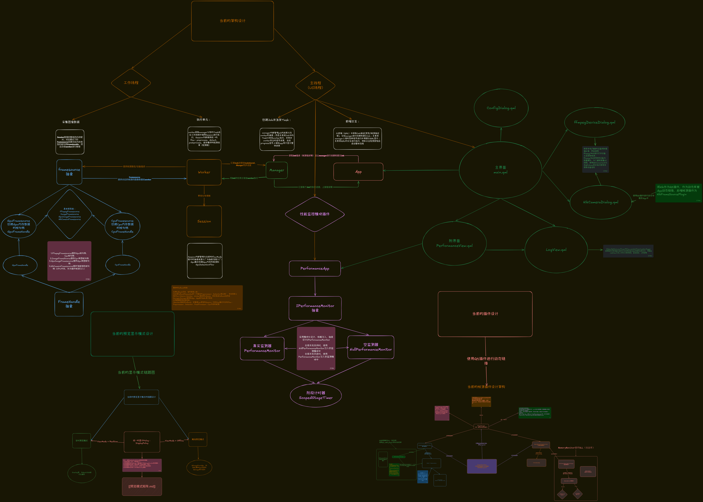

# YOLO：实时目标检测桌面应用

[](LICENSE)
[](CMakeLists.txt)
[](https://www.qt.io/)
[](https://onnxruntime.ai/)
[](https://opencv.org/)

[English](README.md)

这是一个使用 Qt Quick/QML 编写界面、使用 C++ 完成取帧和推理的 YOLO 目标检测桌面项目。当前支持图片、视频文件、通过 FFmpeg 接入的普通摄像头，以及通过 MVS SDK 接入的海康工业相机。

这个项目可以用来测试自己训练并导出格式为 ONNXRuntime 的 YOLO 模型，查看视频或摄像头的检测结果，回看已经处理过的画面，并保存带检测框的图片和视频。也可以通过这个项目了解 QML 与 C++ 如何交接、CPU/GPU 推理流程如何拆分，以及如何对各个阶段进行计时。当前只负责导出模型的推理，模型训练和数据集标注需要在其他工具中完成。

当前的构建和依赖部署主要面向 Windows x64。CMake 中含有 Windows 库文件和 DLL 的处理逻辑，其他平台需要继续调整构建与设备接入代码。

## 目录

- [当前完成](#当前完成)
- [技术栈](#技术栈)
- [项目架构](#项目架构)
- [性能监控](#性能监控)
- [目录结构](#目录结构)
- [编译构建](#编译构建)
- [使用与配置](#使用与配置)
- [模型与输出](#模型与输出)
- [后续计划](#后续计划)
- [常见问题](#常见问题)
- [许可证](#许可证)

## 当前完成
- 创建了统一的基于QT的插件系统，使用统一的抽象接口PluginInterface作为所有插件的基类：
    1. 创建了FrameSourcePluginInterface，作为所有帧源插件的基类,然后创建了HikFrameSourcePlugin海康相机插件类；
    1. 创建了MemoryMonitorPluginInterface，作为内存监控插件的基类，创建了MemoryMonitorPlugin内存监控插件类，
    其中，分为WinMemoryMonitor和LinuxMemoryMonitor两个子类，共同继承MemoryMonitor这个抽象类；
    1. 创建了统一的插件管理类PluginManager，负责加载和管理所有的插件，内部保存有QPluginLoader用来加载插件
    1. 将插件的配置添加到了统一的配置体系中，然后完善了ConfigWriter写入以及ConfigLoader加载配置的逻辑；
- 添加了性能监控中的内存监控模块，添加了QML端的内存扇形图，用来显示内存使用情况；
- 添加了两种系统中的内存监控器，用来获取内存占用快照信息；
- 使用异步操作（QtConcurrent+QFuture）获取设备枚举结果，避免枚举设备功能的UI阻塞。
- 新增统一配置文件和 `ConfigHelper`。启动时读取检测和监控配置，再通过 QML 对话框修改，替换当前写在代码里的默认值。
- 完善 GPU 显示，在 GPU 图像上叠加 CPU NMS 检测框和 Qt Overlay，减少完整图像传回 CPU 以及 CPU 绘制。
- 添加了Gpu设备侧的相关计时，包括预处理kernel以及Overlay互操作转换的计时
- 完成单图片、视频、普通摄像头、海康工业相机和图片/视频混合批量检测。Manager 使用 Job 管理整体进度，Worker 执行其中的 Task。
- 接通 CPU/GPU 两条推理流程。CPU 使用 BGR 帧；GPU 支持 FFmpeg 解码得到的 CUDA/NV12 帧，也支持将 CPU 图片上传到显存后进行推理。
- 接入 FFmpeg 软解和 CUDA 硬解路径。海康相机的枚举、触发模式和采集逻辑封装在独立帧源中。
- 拆分预处理、推理、解析和 NMS。CPU 使用 OpenCV 进行预处理，GPU 使用 BGR/NV12 CUDA kernel；后处理和 NMS 目前在 CPU 中完成。
- 接通 fallback 信号和配置自愈。需要回退的错误由 Worker 重建 CPU 会话并向上同步，普通输入错误只影响当前任务。
- 完成实时预览、有限容量的历史结果回看、任务取消，以及带检测框的图片/视频保存。
- 新增非模态的性能监控页，显示整体统计、阶段耗时和日志。主界面目前也保留 LogView。
- 新增一键示例检测，从程序目录下的 `examples/` 读取图片和模型。构建时会在该目录存在的情况下复制示例资源。

## 技术栈

| 部分 | 当前使用 |
|---|---|
| 语言 | 顶层 CMake 设置为 `C++23`；CUDA 源文件使用`C++17` |
| 界面 | Qt 6、Qt Quick/QML、Quick Controls、Qt Multimedia |
| 推理 | ONNX Runtime，现有依赖配置使用 1.30，包含 CPU/CUDA 执行路径 |
| 图像处理 | OpenCV，现有配置使用 5.0，负责读图、CPU 预处理、绘制和图像转换 |
| 视频与普通摄像头 | FFmpeg，包含软解与 CUDA 硬件上下文 |
| GPU | CUDA Toolkit、cuDNN、自定义 BGR/NV12 预处理 kernel |
| 工业相机 | 海康 MVS SDK；SDK 缺失时配置阶段给出警告并跳过该层 |
| 性能监控 | `IPerformanceMonitor`、`PerformanceMonitor`、`NullPerformanceMonitor`、`ScopedStageTimer` |
| 构建与测试 | CMake、Ninja/MSVC、Qt Test、CTest |

## 项目架构

当前架构由 QML 界面、应用层、核心层和插件层组成。下图展示了当前主要模块及其关系。点击图片可查看原始分辨率版本。

[](docs/assets/project-architecture.png)

更详细的模块职责、线程模型与设计取舍见[架构说明](docs/ARCHITECTURE.md)。

### 当前执行模型

App 提交帧源描述，Manager 根据描述创建 Job 和 Tasks，并将 Task 投递给 Worker。当前 Worker 内部仍然是 `std::queue<std::unique_ptr<DetectionTask>>`，尚未更改为 Job 队列。

Worker 在线程内创建并持有 Session。Session 根据 CPU/GPU 模式选择对应的工厂，创建帧源并持有 Flow。当前 Session 的创建、复用和重建跟随 Worker 的初始化与恢复流程，还没有实现每个 Job 开始时创建、结束时销毁的完整模型。Manager 管理 Job 状态并同步 fallback 信息，Worker 负责实际重建会话。

| 模块 | 职责 |
|---|---|
| `DetectionApp` | 向 QML 提供操作接口，管理检测配置、进度、结果回看和横幅 |
| `DetectionManager` | 创建 Job/Task，汇总 Task 事件，管理取消和 fallback 状态同步 |
| `DetectionWorker` | 管理 Task 队列，执行检测，持有 Session，逐帧上报结果 |
| `DetectionSession` | 保存当前模式，配对帧源工厂和 Flow 工厂，预热，以及 GPU 模式下的 CPU 图片上传 |
| `FrameSource` / `FrameHandle` | 分离输入来源与存储方式，统一图片、FFmpeg、海康相机的帧访问接口 |
| `CpuDetectionFlow` / `GpuDetectionFlow` | 完成预处理、ONNX 推理和通用 CPU 后处理 |
| Renderer / ImageProvider / ResultSaver | 绘制结果，向 QML 提供 QImage 和回看缓冲，保存文件 |
| `PerformanceApp` | 管理监测器生命周期，向 QML 提供配置和统计快照 |

### CPU/GPU 流程与显示
#### 流程：
```text
CPU：CPU BGR 帧 -> CpuPreprocessor -> CpuDetector -> CPU 后处理/NMS
GPU 视频：CUDA/NV12 帧 -> CudaPreprocessor -> GpuDetector -> CPU 后处理/NMS
GPU 图片：CPU BGR 帧 -> Session 上传显存 -> BGR CUDA kernel -> GpuDetector -> CPU 后处理/NMS
```
#### 显示：
分为两种模式：
1. 实时预览模式(Realtime)
1. 离线预览模式(Offline)
具体的模式如下表：

| 用户选的 ViewMode | 生效 FlowMode | 保存    | 实际后端          | 是否下载                |
| ------------- | ----------- | ----- | ------------- | ------------------- |
| Realtime      | GPU，互操作可用   | 关     | Overlay（零拷贝）  | 否，直接使用 GPU 像素       |
| Realtime      | GPU，互操作可用   | **开** | Overlay（零拷贝）  | 是，保存需要渲染            |
| Realtime      | GPU，互操作失败   | 任意    | Overlay（上传）   | 是，需要下载到 CPU 使用      |
| Realtime      | CPU         | 任意    | Overlay（上传）   | 否，直接使用 CPU 数据进行     |
| Offline       | 任意          | 任意    | ImageProvider | 是，需要渲染检测框和转为 QImage |


## 性能监控

当前使用接口加依赖注入的方式接入性能监控。`PerformanceApp` 先于 QML 界面创建，再交给 `DetectionApp`；各层借用 `IPerformanceMonitor` 指针。阶段内使用 `ScopedStageTimer`，退出作用域或主动调用 `end()` 时记录耗时，通过位掩码过滤没有启用的采集点。

`PerformanceMonitor` 使用锁保护统计数据，统一生成快照，再交给 `PerformanceApp` 转换为 QML 属性。内部计时使用纳秒，到显示边界才转换为毫秒。页面可以查看阶段平均值、最大值、样本数、FPS、成功/失败帧数以及端到端统计。仅在检测运行时发送快照。


| 级别 | 当前采集范围 |
|---|---|
| Off | 使用 `NullPerformanceMonitor`，不采集阶段数据 |
| Basic | 端到端耗时、整体帧数和 FPS，启动默认值、预热耗时 |
| Detailed | Basic 加读帧、预处理、推理、后处理、绘制、保存 |
| Full | Detailed 加上传阶段 +GPU设备侧耗时（CUDAkernel以及Overlay的互操作转换） |

默认上报间隔为 300 ms。已启用状态下切换级别或调整上报间隔可以在运行时生效，并重置统计窗口。Off 与启用状态之间的切换会提示需要重启并拒绝本次修改；
当前配置已经有持久化的保存逻辑以及配置加载机制。

## 目录结构

```text
.
├── CMakeLists.txt
├── cmake/
├── src/
│   ├── main.cpp
│   ├── app/
│   │   ├── configs/       # 应用配置读写
│   │   ├── runtime/       # DetectionApp、Manager、Worker、Session、PluginManager
│   │   └── components/    # 结果渲染、保存、日志、性能监控
│   ├── core/
│   │   ├── base/          # 公共类型、错误、插件接口
│   │   ├── frame/         # 帧源、帧句柄与帧源插件接口
│   │   ├── factories/     # CPU/GPU 帧源和推理流程工厂
│   │   ├── inference/     # CPU/GPU 推理流程及前后处理
│   │   ├── cuda/          # CUDA 设备和预处理 kernel
│   │   └── performance/   # 性能监控接口与计时器
│   └── plugins/
│       ├── Hik/           # 海康相机帧源插件
│       └── Performance/   # 性能插件与 Windows/Linux 内存监控器
├── qml/                  # 主界面、配置/设备对话框、性能与日志视图
├── examples/             # 可选示例图片和模型，构建时复制到程序目录
├── tests/                # Qt Test 测试
└── docs/
    ├── ARCHITECTURE.md   # 架构说明
    └── assets/
        └── project-architecture.png
```

## 编译构建

Windows x64，MSVC + Ninja。先进入 x64 的 MSVC 开发者终端（vcvars64）：preset 沿用环境里已有的工具链，不会自己搭一套。

需要支持 C++23 的 MSVC、Ninja，以及 Qt 6（Core、Gui、Qml、Quick、QuickControls2、Multimedia、Test）、OpenCV、ONNX Runtime、FFmpeg 的开发包；GPU 路径还需要 CUDA Toolkit 与 cuDNN。海康 MVS SDK 可选：缺失时构建会跳过海康相机层并给出警告。

### 指定依赖位置

每个依赖目录都从环境变量读取，再转成缓存变量的默认值，每一项也都能用 `-D` 覆盖

| 环境变量 | 指向 |
|---|---|
| `QTDIR` | Qt 6 安装目录（也可以走 `CMAKE_PREFIX_PATH` / `Qt6_DIR`） |
| `YOLO_OPENCV_RELEASE_DIR` | Release 包中含 `OpenCVConfig.cmake` 的目录 |
| `YOLO_OPENCV_DEBUG_DIR` | Debug 包同理；只有 `debug` 构建需要 |
| `ONNXRUNTIME_ROOT` | ONNX Runtime 解压包根目录，含 `include/`、`lib/` |
| `FFMPEG_DIR` | FFmpeg 安装目录，含 `include/`、`lib/`、`bin/` |
| `MVCAM_COMMON_RUNENV` | MVS SDK 根目录；MVS 安装器会自己设置 |

示例：

```powershell
$env:QTDIR = "D:/Qt/6.11.1/msvc2022_64"
$env:YOLO_OPENCV_RELEASE_DIR = "D:/opencv/build"
$env:YOLO_OPENCV_DEBUG_DIR = "D:/opencv/build-debug"
$env:ONNXRUNTIME_ROOT = "D:/onnxruntime-win-x64-gpu_cuda13-1.30.0"
$env:FFMPEG_DIR = "D:/ffmpeg"
$env:MVCAM_COMMON_RUNENV = "D:/MVS/Development"
```

### 配置与构建

```powershell
git clone https://github.com/fanyu99/YOLO-Realtime-Detector.git
cd YOLO-Realtime-Detector
cmake --preset release
cmake --build out/build/release --parallel
.\out\build\release\YOLO.exe
```

`CMakePresets.json` 提供两个 preset：`release`，以及使用 OpenCV Debug 包的 `debug`。它只描述生成器、输出目录和构建类型，不含绝对路径；机器特有的目录放在不入库的 `CMakeUserPresets.json` 里，它继承这些 preset 并补一个 `environment` 块——换机器时照着其中的 `local-deps` 改路径即可。

不用 preset 时，配置方式相同：

```powershell
cmake -S . -B out/build/release -G Ninja
cmake --build out/build/release --parallel
```

### 选项

| 变量（环境变量，或 `-D` 缓存变量） | 默认值或作用 |
|---|---|
| `YOLO_BUILD_DEBUG` | `OFF`：Release 构建 + Release OpenCV 包；`ON`：Debug 构建 + Debug OpenCV 包 |
| `YOLO_ENABLE_HIK` | `ON`；找不到可用的 MVS SDK 时配置阶段给出警告并跳过海康插件；开关保留你的意图，装好 SDK 后重新 configure 即可 |
| `YOLO_ENABLE_CUDA` | `ON`；找不到 Toolkit 时给出警告并跳过自定义 CUDA 源码 |
| `CMAKE_CUDA_ARCHITECTURES` | `120`（Blackwell / RTX 50 系）；按目标显卡设置 |
| `BUILD_TESTS` | `ON`；当 `tests/CMakeLists.txt` 存在时接入 `tests/` |
| `DEPLOY_CUDA_RUNTIME` | `ON`；把 CUDA/cuDNN 运行库复制到程序目录 |
| `DEPLOY_MVS_RUNTIME` | `ON`；把 MVS 运行库复制到程序目录，可用 `MVS_RUNTIME_DIR` 指定位置 |

`FFMPEG_DIR` 是必需的：未设置、或目录下找不到 `libavcodec/avcodec.h` 时，配置会明确报错并停止。`YOLO_OPENCV_*_DIR` 留空也可以——此时 `find_package(OpenCV)` 会走 `OpenCV_DIR`、`CMAKE_PREFIX_PATH` 这些常规途径，把 OpenCV 装在标准位置就不需要额外配置。之所以保留两个变量而不是只留一个 `OpenCV_DIR`：缓存里的单一 `OpenCV_DIR` 在切换 `YOLO_BUILD_DEBUG` 之后仍会指向上一次构建类型的包。

### 运行库部署

Release 构建的主程序位于 `out/build/release/YOLO.exe`，Debug 构建位于 `out/build/debug/YOLO.exe`。运行所需的 OpenCV、ONNX Runtime 以及启用时的 CUDA/cuDNN、MVS 运行库会按配置复制到可执行文件旁；海康和性能插件分别部署在 `plugins/framesource/` 与 `plugins/performance/` 子目录。仓库存在 `examples/` 时，示例资源也会复制到程序目录。应用配置保存在程序目录的 `settings/app.json`。CUDA 与 MVS 运行库部署会探测厂商安装位置（`CUDA_PATH`、`CUDNN_PATH`、`C:\Program Files\...\MVS\Runtime`），未找到时会给出警告。分发构建目录前，请确认目标机器具备所需运行库和硬件条件。

### 测试

```powershell
ctest --test-dir out/build/release --output-on-failure
```

测试源码放在 `tests/` 并纳入 git 追踪；测试用的大体积视频/模型不要入库，通过环境变量指给测试程序。

## 使用与配置

1. 启动 `YOLO.exe`，通过 `修改配置` 选择 ONNX 模型，填写类别名、阈值、输入尺寸、线程数以及 CUDA 设备/模式。修改检测配置前需要先停止检测。
2. 选择单文件或混合批量文件，也可以通过 FFmpeg 设备对话框选择普通摄像头，或选择海康设备和触发模式。示例文件存在时，`示例检测` 会应用示例配置并运行示例图片。
3. 通过上一个、下一个、回到实时查看历史结果。回看缓冲不会主动暂停推理；停止检测可以取消当前流或批量任务。
4. 点击 `性能监控` 打开非模态的统计与日志窗口。需要观察阶段耗时时切换到 Detailed 或 Full。
5. 需要保存结果时，启用 `保存推理结果` 并选择输出目录。

检测配置包括模型路径、按训练顺序排列的类别名、置信度阈值、IoU/NMS 阈值、输入宽高、推理线程数、CUDA 设备编号以及 CPU/GPU 偏好。设置保存在统一配置文件中，并可通过 QML 配置界面修改。模型的固定输入尺寸可能覆盖手动配置并产生提示。

## 模型与输出

当前解析器针对单个 float32 NCHW 输入 `[1, 3, H, W]` 和 `[1, 4 + 类别数, 锚点数]` 输出的 YOLO 检测模型。类别数和锚点数从输出形状推导。其他检测头格式、分割、姿态模型或带内置 NMS 的导出模型，需要修改解析逻辑。类别名顺序必须与训练一致。

示例按钮读取程序旁的 `examples/images/1 (369).jpg` 和 `examples/models/african-wildlife_best.onnx`。目前使用文件系统中的示例资源，旧的 `resources/images.qrc` 路径不再是这里的使用方式。请检查本地或部署目录是否包含这些文件。

带检测框的结果保存在 `<所选目录>/detection_results/` 下，图片为 `.jpg`，视频为 `.mp4`。这些文件用于结果回看，不包含训练标签和评估指标。写入失败会记录错误并停止当前任务的保存，检测继续进行。

## 常见问题

| 问题 | 检查方向 |
|---|---|
| OpenCV 配置或链接失败 | 把 `YOLO_OPENCV_RELEASE_DIR` / `YOLO_OPENCV_DEBUG_DIR` 指向匹配的包，并保持编译器与位数一致 |
| 找不到 FFmpeg 头文件或库 | 检查 `FFMPEG_DIR`（`include/`、`lib/`、`bin/`）以及 CMake 需要的导入库 |
| 找不到 `MvCameraControl` 或启动缺 DLL | 设置 `MVCAM_COMMON_RUNENV`（或 `-DMVS_SDK_ROOT=`）；检查部署的运行库与 PATH。缺 DLL 说明海康层已经编入，即配置时 SDK 是存在的 |
| GPU 模式回退 | 检查编译支持、CUDA/cuDNN/ORT 运行库兼容性、GPU 架构和 fallback 日志 |
| 没有阶段统计 | Basic 只采集端到端数据，切换 Detailed/Full 并运行检测 |
| 无法切换监控开关 | Off 与启用状态之间的切换需要重启；相关设置通过统一配置文件保存 |
| 示例检测没有结果 | 检查程序旁 `examples/` 下是否存在图片和模型 |
| 框位置或类别不正确 | 检查模型检测头、输入尺寸、类别顺序以及预处理警告 |

## 许可证

项目使用 [MIT](LICENSE) 许可证。Qt、OpenCV、ONNX Runtime、FFmpeg、CUDA/cuDNN 和 MVS SDK 保留各自的许可与分发要求，发布程序时需要检查所使用依赖包的具体许可证。
